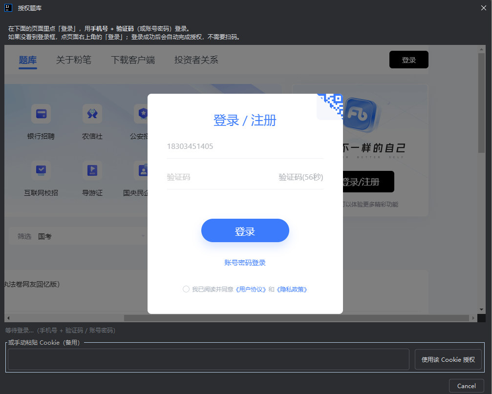
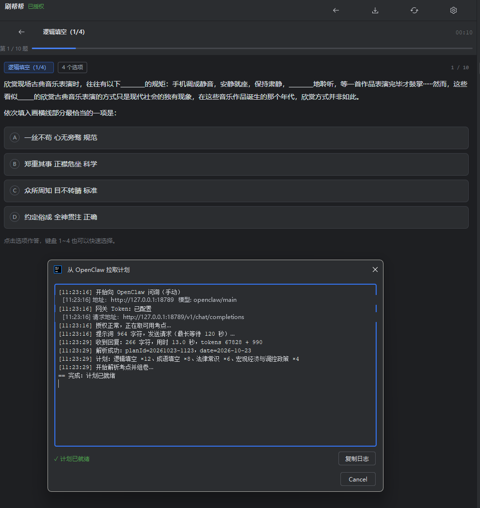
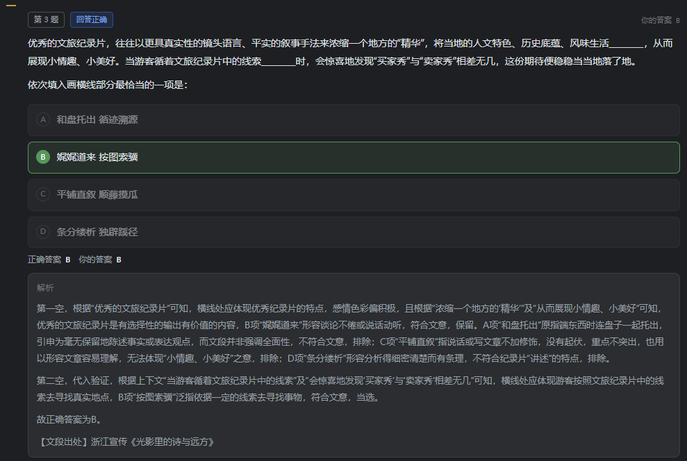

<div align="center">

# 刷帮帮

**在 JetBrains IDE 里刷行测 / 申论题，顺手把 OpenClaw 的每日计划接进来。**

一次授权，之后静默拉题；手动或定时向 OpenClaw 问询「题型 + 数量」，按计划逐项组卷；
交卷后把成绩回传，让大模型分析薄弱点。


</div>

> **非官方插件**，与粉笔官方无关。仅用于个人学习，请遵守题库服务的使用条款。

---

## 目录

- [特性](#特性)
- [界面预览](#界面预览)
- [快速开始](#快速开始)
- [使用说明](#使用说明)
- [连接 OpenClaw](#连接-openclaw)
- [配置与安全](#配置与安全)
- [从源码构建](#从源码构建)
- [项目结构](#项目结构)
- [常见问题](#常见问题)
- [参与贡献](#参与贡献)
- [免责声明](#免责声明)
- [License](#license)
- [联系与支持](#联系与支持)

---

## 特性

| | |
| --- | --- |
| **一次授权** | 内嵌浏览器用手机号 + 验证码（或账号密码）登录，自动读取 Cookie；之后不再弹登录框。支持手动粘贴 Cookie 兜底 |
| **题库拉取** | 行测分类逐级下钻，细考点精确匹配；申论支持真题试卷、材料、作答与参考答案 |
| **逐题作答** | 题干 / 选项 / 图片原样渲染，点选项作答，`1`~`4` 快速选择；交卷后统一展示对错与解析 |
| **错题本** | 答错的题自动加密收录，可回看解析、按考点重练、删除或清空 |
| **练习统计** | 近 7 天题量、正确率、分类正确率、连续天数，交卷自动累计 |
| **断点续做** | 计划、题号、已完成小结加密保存在本地，退出 IDE 后一键继续 |
| **历史记录** | 每次计划一条记录，显示完成百分比、正确率、用时，最多保留 200 条 |
| **OpenClaw 联动** | 手动或定时向 OpenClaw 问询「题型 + 数量」，按计划串行组卷；做完自动回传成绩并展示薄弱点分析 |
| **休息计划** | 大模型判断今天该休息时返回 `rest: true`，插件只提醒、不组卷 |
| **配置加密** | 地址、Token、Cookie 等统一 AES-256-GCM 加密落盘，不写明文 |
| **摸鱼友好** | 深 / 浅色自适应，`Ctrl+Alt+F` 一键隐藏 / 呼出面板 |

---

## 界面预览

### 授权（手机号 + 验证码 / 账号密码）



### 做题 + 从 OpenClaw 拉取计划



### 交卷后的成绩与解析



---

## 快速开始

### 1. 安装

从 [Releases](https://github.com/shihaor/gongkao-idea-plugin/releases) 下载最新的
`shuabangbang-x.y.z.zip`，然后：

```
Settings → Plugins → ⚙ → Install Plugin from Disk… → 选择 zip → 重启 IDE
```

安装后右侧出现「刷帮帮」面板，或按 `Ctrl+Alt+F` 呼出。

> 兼容 IntelliJ IDEA / WebStorm / PyCharm 等 2023.3+ 的 JetBrains IDE。
> 若提示版本不兼容，把 `build.gradle.kts` 里的 `untilBuild` 放宽后重新打包。

### 2. 授权题库

`设置 → 题库授权 → 授权题库`，在弹出的页面里用**手机号 + 验证码**登录。
登录成功后 2~3 秒自动完成授权，窗口自动关闭。

- 页面没有登录框时，点网页右上角「登录」
- 内嵌浏览器不可用时，可在弹窗底部手动粘贴 Cookie

### 3. 开始刷题

- **手动**：题库页选分类 → 直接组卷
- **按计划**：点右上角 **⤓** 拉取 OpenClaw 计划 → 自动进入第一题

---

## 使用说明

### 手动刷题

1. 切到「行测」或「申论」页签
2. 单击分类（带箭头的可继续下钻）
3. 点选项作答，`1`~`4` 也可选择
4. 最后一题点「交卷」，查看成绩与逐题解析

> 受接口限制，**单题对错与解析在交卷后统一展示**，不是点完立即判分。

### 手动拉取计划并开始

点面板右上角 **⤓**（或 `设置 → 立即问询`）：

1. 弹出「从 OpenClaw 拉取计划」窗口，实时显示请求、耗时、Token 用量、解析结果
2. 拿到计划后自动解析考点、逐个组卷，直接进入第一题
3. 一项做完点「下一项」，全部完成后自动回传成绩并请求分析

### 返回刷题

右上角 **‹**：有一组没交卷的题时，直接回到当前题；否则回到题库。

### 错题本

题库页第三个页签「错题本」会自动收录**交卷时答错**的题：

- 记录题干、选项、你的答案、正确答案、解析
- 单击查看详情
- 「按考点重练」按该考点重新组卷（不保证抽到同一题）
- 支持删除单题、清空整个错题本
- 加密保存在 `~/.fenbi-plugin/wrongbook.bin`，最多保留 500 题

> 单题对错只有交卷后才知道，所以错题是在交卷那一刻写入的。

### 统计

题库页第四个页签「统计」：

- 今日题量、今日正确率、连续天数
- 近 7 天题量柱状图（今天高亮）
- 近 7 天分类正确率（按题量排序，绿色 ≥75%，黄色 <60%）

数据加密保存在 `~/.fenbi-plugin/stats.bin`，保留最近 60 天。手动练习和计划模式都会累计。

### 断点续做

做计划时中途退出 IDE、或返回题库，面板顶部会出现：

```
上次计划未完成：2/4 项 · 第 5/10 题（资料分析）    [继续] [放弃]
```

- 点「继续」直接回到上次那道题，已选项由题库接口恢复
- 点「放弃」清空这次计划的进度
- 计划、exerciseId、题号、已完成项的小结都加密存在 `~/.fenbi-plugin/plan-state.bin`
- 同一天多个 IDE 实例共享「已拉取」标记，不会重复问询大模型

> 只保留当天的计划；跨天后不会提示续做。

### 历史记录

题库页第五个页签「历史」：

- 每次计划**完成或中断**都会留下一条记录
- **拉题后立即出现一条「待开始」记录**，开始做题后变为「进行中」，百分比随题号实时更新
- 显示**完成百分比**（完成题数 / 计划题数）、正确率、用时、题型明细
- 正在做的计划排在最上面，标注「进行中」
- **点「待开始/进行中」的记录 → 直接继续做题**
- **点「已完成/已中断」的记录 → 查看逐项明细和错题**
- 最多保留 200 条，加密保存在 `~/.fenbi-plugin/history.bin`

### 快捷键

| 快捷键 | 作用 |
| --- | --- |
| `Ctrl + Alt + F` | 显示 / 隐藏面板 |
| `1` ~ `4` | 选择 A~D |
| `←` / `→` | 上 / 下一题 |

---

## 接入大模型 / OpenClaw

插件只依赖 **OpenAI 兼容的 `/v1/chat/completions`**，OpenClaw 只是其中一种接法。

### 直连大模型（不用 OpenClaw）

填「接口地址 + API Key + 模型」即可，Webhook 留空：

| 服务 | 接口地址 | 模型示例 |
| --- | --- | --- |
| DeepSeek | `https://api.deepseek.com` | `deepseek-chat` |
| OpenAI | `https://api.openai.com` | `gpt-4o-mini` |
| Moonshot | `https://api.moonshot.cn` | `moonshot-v1-8k` |
| Ollama | `http://localhost:11434` | `qwen2.5:7b` |
| OpenClaw | `http://127.0.0.1:18789` | `openclaw/main` |

> 接口地址需要最终能访问到 `…/v1/chat/completions`；带不带 `/v1` 都可以，插件会自动归一化。

直连大模型没有长期记忆，所以插件会把**上一次的练习报告**（`~/.fenbi-plugin/last-report.json`）带进提示词，让模型根据薄弱点安排。

### 为什么是「插件拉取」

OpenClaw 通常部署在云服务器，插件在本机 NAT 后面。云端无法主动调你的 IDE，
所以方向反过来：**插件定时向 OpenClaw 问询，拿到计划后本地组卷**。

```
插件 --(每天 9:00 后，每 2.5 小时)--> POST /v1/chat/completions
     <--(计划 JSON)----------------
插件 解析考点 → 组卷 → 你答题
插件 --(交卷后)--> POST /v1/chat/completions  分析薄弱点
     <--(分析文本)----------------- 显示在报告页
插件 --(可选)----> POST /hooks/wake          推送到 IM
```

### OpenClaw 侧准备

`~/.openclaw/openclaw.json`：

```json5
{
  "gateway": {
    "http": {
      "endpoints": {
        "chatCompletions": { "enabled": true }
      }
    }
  },
  "hooks": {
    "enabled": true,
    "token": "一条独立的随机串"
  }
}
```

```bash
openclaw config validate
openclaw gateway restart
```

验证：

```bash
curl -sS http://127.0.0.1:18789/v1/models \
  -H 'Authorization: Bearer <你的 Gateway Token>'
```

返回 `openclaw/main` 之类即正常。

### 插件侧配置

`设置 → 大模型 / OpenClaw`：

| 字段 | 说明 |
| --- | --- |
| 接口地址 | `https://api.deepseek.com` 或 `http://127.0.0.1:18789`，带不带 `/v1` 都行 |
| API Key | 服务的 Key；OpenClaw 填 `gateway.auth.token` |
| 模型 | 如 `deepseek-chat`、`gpt-4o-mini`、`openclaw/main` |
| 开始时间 | 默认 9 点，之后才开始轮询 |
| 问询间隔 | 默认 150 分钟（2.5 小时） |
| 上报地址（可选） | 留空则走网关的 `/v1/chat/completions`；也可填 `/hooks/wake` 或映射地址 |
| 上报 Token（可选） | 留空则用网关 Token |

### 计划协议

大模型需要输出这样的 JSON：

```json
{
  "planId": "20261023-0900",
  "date": "2026-10-23",
  "rest": false,
  "deadline": "23:30",
  "items": [
    { "type": "逻辑填空", "count": 12 },
    { "type": "资料分析", "count": 8 }
  ],
  "note": "上午碎片时间做逻辑填空，午休做资料分析"
}
```

- `type` 为粉笔考点名，插件会在分类树里递归匹配（精确 → 包含 → `path` 消歧）
- 可选 `path` 用于消歧：`"path": ["言语理解与表达"]`
- 每个考点单独组卷，按顺序执行
- 休息时返回：`{ "rest": true, "items": [], "note": "今天休息" }`

### 成绩回传

```json
{
  "planId": "20261023-0900",
  "finishedAt": "2026-10-23T21:52:10",
  "elapsedSeconds": 1830,
  "total": 20,
  "correct": 14,
  "accuracy": 0.7,
  "items": [
    {
      "type": "逻辑填空",
      "path": "言语理解与表达 / 逻辑填空",
      "total": 12,
      "correct": 9,
      "seconds": 900,
      "wrong": [
        { "questionId": 123, "stem": "……", "your": "B", "correct": "C" }
      ]
    }
  ]
}
```

- 分析结果显示在报告页顶部，并弹一条通知
- 报告同时落盘到 `~/.fenbi-plugin/last-report.json`
- 配置了 Webhook 时，还会把「成绩 + 分析」推送到 IM

### 每次交卷的 practice_result

每次交卷（手动练习、计划中的每一项）除了最终报告，还会立即向 Webhook 回传一条：

```json
{
  "action": "practice_result",
  "date": "2026-10-23",
  "planId": "20261023-1413",
  "submittedAt": "16:40",
  "modules": [
    { "type": "逻辑填空", "total": 12, "correct": 9, "wrong": 3, "accuracy": 75, "avgSecPerQ": 45 }
  ],
  "wrongItems": [
    { "type": "逻辑填空", "reason": "", "note": "", "questionId": 123,
      "stem": "……", "your": "B", "correct": "C" }
  ],
  "overall": { "total": 12, "correct": 9, "durationMin": 9 },
  "selfComment": ""
}
```

- 计划模式按**累计进度**发送，`modules` 是已完成的所有项
- 手动练习的 `planId` 为 `manual-yyyyMMdd-HHmm`
- `reason` / `note` / `selfComment` 由插件留空，交给 OpenClaw 侧分析填充
- **上报地址留空时**，通过网关的 `/v1/chat/completions` 发送，会话键仍是 `conv:fenbi-idea-plugin`（和拉取同一个会话）
- 交卷后状态栏显示「已上报：逻辑填空」；失败会弹一次通知

### 调度规则

- 每天 `开始时间`（默认 9:00）后开始检查，间隔默认 150 分钟
- IDE 启动时若在时间段内，会先检查一次
- 当天已拿到计划（无论是否开始）就不再自动问询，次日恢复
- 手动「立即问询」不受时间窗口限制

---

## 配置与安全

所有配置与错题本统一加密保存：

```
~/.fenbi-plugin/config.bin      # 配置
~/.fenbi-plugin/wrongbook.bin   # 错题本（最多 500 题）
~/.fenbi-plugin/stats.bin       # 练习统计（最近 60 天）
~/.fenbi-plugin/plan-state.bin  # 未完成计划与进度
~/.fenbi-plugin/history.bin     # 历史做题记录（最多 200 条）
```

- 算法：**AES-256-GCM**（随机 IV）
- 密钥：由内置口令 `shr123456789000` 经 SHA-256 派生
- 内容：网关地址、Token、模型、Webhook、Cookie、题量、问询时间 / 间隔

> **安全说明**：密钥固定在内置代码里，能避免配置文件被直接读取或误传，
> 但无法抵御反编译。如果你的场景需要更强保护，应改为启动时手动输入口令。

旧版本存在 `PropertiesComponent` / `PasswordSafe` 中的配置，会在首次读取时自动迁移。

---

## 从源码构建

### 环境

- JDK 17+
- Gradle 8.x（仓库自带 wrapper）
- IntelliJ IDEA 2024.3（用于本地 SDK）

### 构建

```bash
git clone https://github.com/shihaor/gongkao-idea-plugin.git
cd gongkao-idea-plugin

# Windows：用本机已安装的 IDEA 作为 SDK，避免下载 1GB
set JAVA_HOME=J:\IntelliJ IDEA 2024.3.1.1\jbr
gradlew.bat -PintellijLocalPath="J:/IntelliJ IDEA 2024.3.1.1" buildPlugin

# macOS / Linux
export JAVA_HOME=/Applications/IntelliJ\ IDEA.app/Contents/jbr/Contents/Home
./gradlew -PintellijLocalPath="/Applications/IntelliJ IDEA.app" buildPlugin

# 不传 intellijLocalPath 时，Gradle 会自动下载 IntelliJ Platform 2024.3
```

产物：`build/distributions/shuabangbang-x.y.z.zip`

### 调试

```bash
./gradlew runIde
```

会启动一个装了插件的沙箱 IDE。

> 本机调试时用 `-PintellijLocalPath=...` 指向已安装的 IDEA；不传则自动下载
> IntelliJ Platform 2024.3（首次约 1GB）。

---

## 项目结构

```
.
├── src/main/java/com/fenbi/plugin/
│   ├── FenbiToolWindowFactory.java   # Tool Window 入口
│   ├── FenbiToggleAction.java        # Ctrl+Alt+F
│   ├── PlanStartupActivity.java      # 启动后开始计划轮询
│   ├── model/Models.java             # 题目 / 计划 / 报告模型
│   ├── service/
│   │   ├── FenbiApi.java             # 题库接口封装
│   │   ├── FenbiSession.java         # 授权与 API 实例
│   │   ├── OpenClawClient.java       # OpenAI 兼容接口 / hooks
│   │   ├── PlanService.java          # 计划轮询与通知
│   │   ├── PlanSession.java          # 一次计划的执行与汇总
│   │   ├── WrongBook.java            # 本地错题本（AES-GCM）
│   │   ├── Stats.java                # 练习统计（AES-GCM）
│   │   ├── PlanStore.java            # 未完成计划与进度（AES-GCM）
│   │   ├── History.java              # 历史做题记录（AES-GCM）
│   │   └── SecureConfig.java         # AES-GCM 配置存储
│   ├── ui/
│   │   ├── FenbiPanel.java           # 主面板与导航
│   │   ├── BankPanel.java            # 题库 / 申论 / 错题本 / 统计 / 历史
│   │   ├── WrongBookPanel.java       # 错题本列表与详情
│   │   ├── StatsPanel.java           # 近 7 天统计图表
│   │   ├── HistoryPanel.java         # 历史完成百分比
│   │   ├── QuizPanel.java            # 做题
│   │   ├── ReviewPanel.java          # 成绩与解析
│   │   ├── EssayPanel.java           # 申论
│   │   ├── SettingsPanel.java        # 设置
│   │   ├── LoginDialog.java          # 授权
│   │   └── PlanPullDialog.java       # 拉取过程日志
│   └── util/                         # 异步、HTML 渲染
├── src/main/resources/META-INF/plugin.xml
├── docs/方案设计.md                   # 接口与设计说明
├── prototype/index.html              # 可点击的界面原型
└── images/                           # 截图
```

---

## 常见问题

<details>
<summary><b>点「拉取」报 405 Invalid HTTP method</b></summary>

网关不接受 Java HttpClient 默认的 HTTP/2（h2c 升级）。插件已强制 HTTP/1.1，
如果仍然出现，请确认版本 ≥ 0.3.5。
</details>

<details>
<summary><b>提示「OpenClaw 未配置完整」</b></summary>

网关 Token 没保存。到 `设置 → OpenClaw 联动` 填写后点「保存并生效」，
再点右上角 ⤓（新版本会自动先保存）。
</details>

<details>
<summary><b>401 / 403</b></summary>

- 401：Token 不对，或 Gateway 的 `gateway.auth.token` 与插件里填的不一致
- 403：网关开启了 trusted-proxy 等模式，需要走对应的代理
</details>

<details>
<summary><b>一直停在「正在问询」</b></summary>

点 ⤓ 后会弹出实时日志窗口，上面会显示卡在哪一步：
取考点、发送请求、等待回复（最长 120 秒）、解析。把日志复制出来即可定位。
</details>

<details>
<summary><b>题目区域空白</b></summary>

IDE 未启用 JCEF。`Help → Find Action → Registry`，确认
`ide.browser.jcef.enabled` 已勾选，然后重启。
</details>

<details>
<summary><b>OpenClaw 收不到交卷记录</b></summary>

- 上报地址留空时，插件走网关的 `/v1/chat/completions`，会话键 `conv:fenbi-idea-plugin`
- 只要「接口地址 + API Key」配好就会发，不需要额外配 hooks
- 每次交卷后看状态栏是否出现「已上报：逻辑填空」
- 失败会弹一次通知，点「去配置」检查地址/Token
- 如果填了「上报地址」为 `/hooks/wake`，需要 `hooks.enabled` 和单独的 `hooks.token`
</details>

<details>
<summary><b>退出后计划没了 / 无法继续</b></summary>

会把计划和进度加密保存在 `~/.fenbi-plugin/plan-state.bin`。
重新打开 IDE，面板顶部会出现「上次计划未完成」，点「继续」即可回到上次的题号。
只保留当天的计划；跨天后需要重新拉取。
</details>

<details>
<summary><b>同一天被问了三次计划</b></summary>

旧版本只在当前 IDE 的配置里记「已拉取」，多个 IDE 实例会各自问一次。
新版本改用 `~/.fenbi-plugin/plan-state.bin` 共享标记，同一天只问一次。
</details>

<details>
<summary><b>错题本没有记录</b></summary>

错题是在**交卷**时写入的，中途返回题库不会记录。同一道题再次答错会累计次数，
答对不会自动删除历史错题（可手动删除）。
</details>

<details>
<summary><b>登录后一直等待</b></summary>

确认网页已经跳到登录后的状态；或在弹窗底部手动粘贴 Cookie。
Cookie 过期时会收到「授权已失效」通知，重新授权即可。
</details>

---

## 参与贡献

欢迎 Issue / PR：

1. Fork 本仓库
2. 新建分支：`git checkout -b feat/your-feature`
3. 提交：`git commit -m "feat: ..."`
4. 推送并发起 Pull Request

提交前请确保 `./gradlew buildPlugin` 通过。

---

## 免责声明

- 本项目为**非官方**工具，与粉笔官方无任何关联
- 题库数据来自题库网页版接口，仅用于个人学习
- 请勿用于商业用途、批量抓取或自动化刷题，以免违反服务条款
- 使用本插件产生的任何后果由使用者自行承担

---

## License

[MIT](LICENSE) © 2026 SHR

---

## 联系与支持

<div align="center">

| 加我好友 | 请我喝咖啡 |
| --- | --- |
|  |  |

</div>

如果这个项目帮到了你，点个 ⭐ 就是最大的支持。
